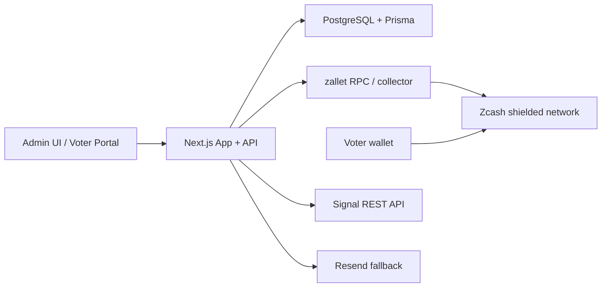

# Architecture

Reviewed 9 October 2026. This document describes current implementation layers. See the [implementation review](./implementation-status.md) for incomplete guarantees and the [roadmap](./roadmap.md) for their delivery order.

## System Components

## Layers

### App layer
- Next.js UI
- API routes for admin, auth, polls, voting, and reconcile
- ZIP-321 QR generation
- Signal invite delivery, legacy email fallback, and receipt email orchestration

### State layer
- Communities and administrative user memberships
- DAO voting rosters, currently separate from permanent user accounts
- Proposal content, tags, discussions and profile preferences
- Recorded treasury balances and append-only funding/allocation journals
- Participation policies, Zcred accounts, journals and purchase invoices
- Polls
- Voter access records
- Ticket assignments
- Vote requests
- Receipts
- Reconciled tally

### Collector layer
- `zallet` RPC
- shielded address generation
- incoming note observation
- anchor transaction submission

The credit-payment observer is separate from the voting collector. It reads each DAO's configured wallet and an independent chain endpoint, then reconciles invoice receipts and credits. Its fixtures do not establish live wallet operation. See the [observer contract](./credit-payment-observer.md).

### Zcash layer
- shielded transfer transport
- anchor submission and txid persistence; independent inclusion confirmation is still required
- one-block confirmation used for receipt finalization

## Core Product Separation

- **Community workspace** supplies public proposal reading and protected discussion, Members, Treasury and account settings
- **Admin dashboard** manages poll lifecycle, voter rows, delivery, and results
- **Voter portal** handles one-time invite sessions, answer choice, QR locking, and receipt status
- **Public board** lists OPEN, CLOSED, FINALIZED and ARCHIVED polls; its live OPEN results still need alignment with the publication policy used elsewhere
- **Proposal funding** stores USD cents and commits to payment-day ZEC settlement; [indicative quotes](./proposal-funding.md) save dated, expiring market references without authorizing payments or changing balances
- **Treasury journal** records ZEC balances in zatoshis; it neither reconciles wallet balances nor signs payments
- **Credit purchases** attribute confirmed incoming payments to internal usage credits; they do not grant membership or voting power
- **Coinholder analytics** belongs in OpenZcash; this repository retains legacy source without a primary navigation link

## Boundaries to complete

Closing now preserves outstanding requests and leaves membership decisions pending. The [closure-safety slice](./voting-finalization.md) supplies no automatic finalizer: complete collection/cutoff evidence remains required. Stable membership/account binding, published revision history, shared result-publication policy, budget lifecycle and payment exception recovery are also incomplete. Follow the [review findings](./implementation-status.md#findings-that-determine-the-next-work) before enabling binding governance.
